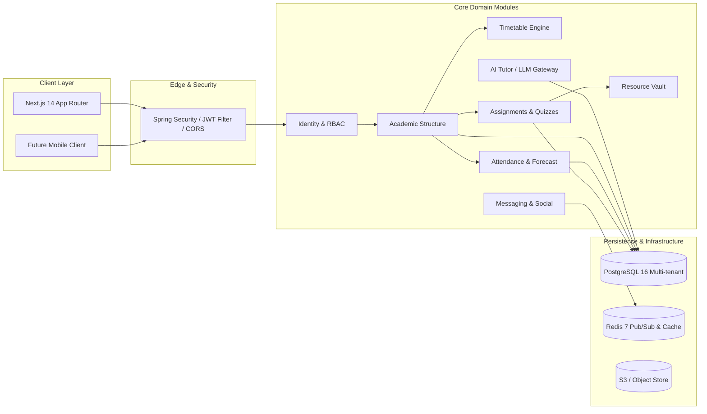
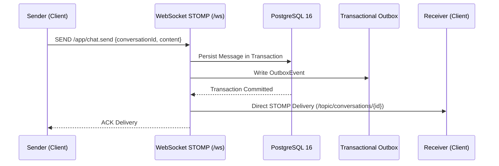

# CampusOS Architecture Specification

## 1. Architectural Philosophy & Style

CampusOS is structured as a **Modular Monolith** with clear bounded contexts, designed for operational simplicity in single-institution deployments while maintaining strict logical multi-tenancy for seamless horizontal scaling across university systems.



---

## 2. Core Domain Modules

| Module | Responsibility | Key Entities |
|---|---|---|
| **Identity & Access** | Authentication, JWT issuing, role permissions, multi-tenant context. | `UserAccount`, `UserProfile`, `UserRole`, `Institution`, `Campus` |
| **Academic Core** | Hierarchy of courses, departments, terms, sections, and rosters. | `Department`, `Program`, `AcademicTerm`, `Subject`, `CourseOffering`, `Section`, `Enrollment`, `TeacherProfile`, `StudentProfile` |
| **Timetable** | Server-authoritative scheduling, room assignments, cancellations. | `ClassSession`, `TimetableRule`, `Room` |
| **Attendance** | Atomic roster recording, institutional policy enforcement, recovery math. | `AttendancePolicy`, `AttendanceSession`, `AttendanceRecord`, `AttendanceAuditEvent` |
| **Assessments & Grading** | Assignments, submissions, rubrics, versioning, gradebook. | `Assignment`, `AssignmentSubmission`, `Grade`, `Quiz`, `QuizQuestion`, `QuizAttempt` |
| **Resource Vault** | Secure document distribution, metadata indexing, signed downloads. | `Resource`, `ResourceVersion`, `DocumentChunk` |
| **Community & Real-time** | Sections chats, peer DMs, friend requests, event outbox. | `Conversation`, `ConversationMember`, `Message`, `Friendship`, `Notification` |
| **AI Assistant** | Provider-neutral LLM adapter (external + Ollama), grounding, chat logs. | `AiConversation`, `AiMessage`, `AiModelUsage` |
| **Career & Showcase** | Verified tech events, internships, student collaborative project portfolios. | `Opportunity`, `StudentProject`, `ProjectMember` |

---

## 3. Multi-Tenancy Strategy

### 3.1 Logical Data Isolation
Every core table contains an `institution_id` foreign key. Query execution follows strict defense-in-depth:
1. User claims extracted from authenticated JWT contain `institutionId` and `roles`.
2. Services query database repositories using explicit tenant filters:
   ```java
   @Query("SELECT s FROM Section s WHERE s.institution.id = :institutionId AND s.id = :sectionId")
   Optional<Section> findByTenantAndId(UUID institutionId, UUID sectionId);
   ```
3. Direct Object References (IDOR) are prevented by asserting that the requesting user's tenant matches the target record's tenant before executing mutations.

---

## 4. Attendance Mathematics & Forecasting Engine

Attendance policies are configured per institution (default threshold $T = 75\% = 0.75$).

### Real-Time Formula:
$$\text{Attendance Percentage} = \frac{\text{Eligible Attended Classes}}{\text{Eligible Conducted Classes}} \times 100$$

### Recovery Forecasting:
If $\text{Percentage} < T$:
$$\text{Classes Needed to Recover} = \left\lceil \frac{T \times \text{Conducted} - \text{Attended}}{1 - T} \right\rceil$$

### Absence Margin:
If $\text{Percentage} \ge T$:
$$\text{Safe Absences Possible} = \left\lfloor \frac{\text{Attended}}{T} - \text{Conducted} \right\rfloor$$

---

## 5. Real-Time & Eventing Architecture



---

## 6. AI Gateway & Local Model Fallback

The `AiAssistantService` provides an abstraction layer over diverse LLM backends:
1. **Primary Provider:** OpenAI / Claude API gateway.
2. **Local Provider:** Ollama endpoint (`http://localhost:11434/api/generate`) for on-premises, privacy-first university deployments.
3. **Context Grounding:** Course syllabus and uploaded lecture summaries are injected into system prompts to ensure responses strictly reflect current academic requirements.
