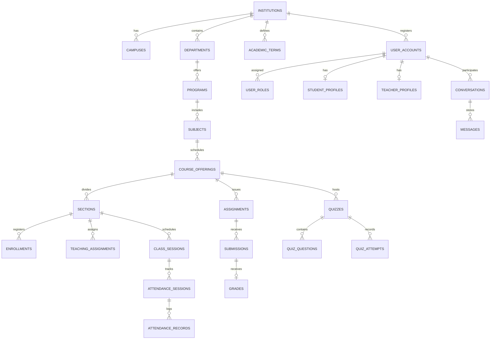

# CampusOS Database Design & Schema Specification

## 1. Overview & Engine
- **Engine:** PostgreSQL 16
- **Migration Manager:** Flyway (`src/main/resources/db/migration/`)
- **Primary Keys:** Version 4 UUIDs (`gen_random_uuid()`)
- **Timestamp Strategy:** UTC `TIMESTAMPTZ` with automatic `CURRENT_TIMESTAMP` defaults

---

## 2. Entity-Relationship Model

---

## 3. Core Database Tables & Indexes

### 3.1 Tenant & Identity Structure
- `institutions`: Root tenant record (code, name, status, config).
- `user_accounts`: Primary credentials, password hash, status (`ACTIVE`, `SUSPENDED`).
- `user_roles`: Role assignments (`ROLE_STUDENT`, `ROLE_TEACHER`, `ROLE_ADMIN`).
- `student_profiles`: Roll numbers, semester, section associations.
- `teacher_profiles`: Faculty designations, department affiliations.

### 3.2 Academic Operations & Timetable
- `subjects`: Code (`CS101`), credits, theory/practical classification.
- `course_offerings`: Subject mapped to an academic term.
- `sections`: Batch subdivisions (`Section A`, `Section B`).
- `enrollments`: Many-to-many relationship linking students to active sections.
- `class_sessions`: Scheduled lectures with `start_time`, `end_time`, `room_id`, and `status`.

### 3.3 Attendance & Audit Trails
- `attendance_sessions`: Realized lecture sessions mapped to class sessions.
- `attendance_records`: Individual student marks (`PRESENT`, `ABSENT`, `EXCUSED`, `LATE`).
  - *Unique Index:* `idx_att_rec_unique` on `(attendance_session_id, student_id)` prevents duplicate records.
- `attendance_audit_events`: Audit log recording adjustments made by teachers with reason codes and timestamps.

### 3.4 Assessment Engine & Gradebook
- `assignments`: Published coursework, submission deadlines, maximum marks, rubrics.
- `submissions`: File path, text body, server-validated submission timestamp.
- `grades`: Points awarded, grader feedback, publication status (`DRAFT`, `PUBLISHED`).
- `quizzes`: Timed assessments with duration limits.
- `quiz_questions`: Question types (`MULTIPLE_CHOICE`, `SHORT_ANSWER`), options, and correct answers.
- `quiz_attempts`: Server-graded attempt logs with total scores.

### 3.5 Real-Time Messaging & Outbox
- `conversations`: Group and direct messaging channels.
- `conversation_members`: Channel permissions and member state.
- `messages`: Persistent text content, sender associations, and delivery timestamps.
- `outbox_events`: Event records for reliable downstream notification fanout.

---

## 4. Flyway Migrations
All schema updates are strictly version-controlled in SQL files located at:
`backend/src/main/resources/db/migration/`

- `V1__init_schema.sql`: Initial creation of all 40+ normalized tables, composite unique keys, and B-tree indexes for fast tenant filtering.
