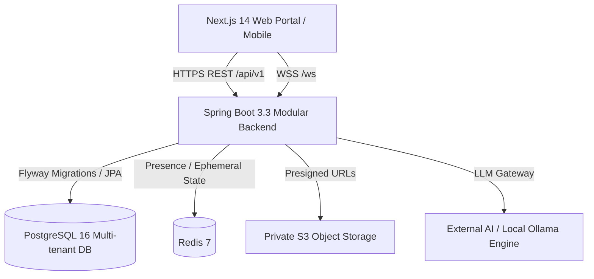

# CampusOS — The Connected Higher Education Platform

[](https://www.oracle.com/java/)
[](https://spring.io/projects/spring-boot)
[](https://nextjs.org/)
[](https://www.postgresql.org/)
[](LICENSE)

CampusOS is a production-grade, multi-tenant digital campus operating system designed for modern universities and colleges. It unifies academic operations, teaching workflows, attendance tracking with recovery forecasting, timed assessments, course resources, direct and group messaging, AI-powered study assistance, and student project portfolios into a single system.

---

## 🏛️ System Architecture Overview



### Key Engineering Principles
- **No Fabricated Production Data:** Zero hardcoded fallback mocks. The application displays clean, informative empty states until authorized records are persisted.
- **Multi-Tenant Foundation:** Database entities are partitioned with composite tenant keys (`institution_id`, `campus_id`, `department_id`).
- **Server-Authoritative Business Logic:** Timetable countdowns, attendance percentages, recovery forecasts, quiz scoring, and deadline validations are strictly computed on the backend.
- **Durable Real-Time & Eventing:** Persistent direct/group messaging via WebSockets with transactional outbox event delivery.

---

## ✨ Feature Highlights

### 👨‍🎓 Student Portal
1. **Command Dashboard:** Live class countdown, today's schedule, pending tasks, recent announcements, and real attendance summary.
2. **Timetable:** Interactive day/week grid with server-calculated transition times and room change notifications.
3. **Attendance & Recovery Calculator:** Subject-wise percentage calculation with exact mathematical forecasting:
   - *Classes needed to reach target %*
   - *Safe margin of absences before falling below threshold*
4. **Course Hub & Resources:** Download lecture notes, slides, syllabus docs with version tracking.
5. **Assignments & Submissions:** Server-side timestamped submissions with idempotency protection.
6. **Timed Quizzes:** Live countdown assessments with server-side response scoring.
7. **Marks & Gradebook:** Transparent view of published assignment, quiz, and exam results.
8. **Planner & Study Tasks:** Personal calendar and to-do lists linked directly to academic deadlines.
9. **Community & Chat:** Subject groups, peer direct messaging, and friend discovery.
10. **AI Tutor:** Syllabus-grounded concept explanations and step-by-step problem solver.
11. **Career & Portfolio:** Verified hackathons, internships, and student collaborative project showcases.

### 👩‍🏫 Faculty / Teacher Portal
1. **Teaching Dashboard:** Daily lecture schedule, pending grading queue, and active course offerings.
2. **Atomic Attendance Recorder:** Roster-based one-click attendance recording with duplicate prevention and audit logging.
3. **Assignment Studio:** Create assignments with rich instructions, deadlines, and rubrics. Grade submissions with personalized feedback.
4. **Quiz Builder:** Question bank manager supporting multiple-choice and short answers with automated grading keys.
5. **Resource Management:** Upload PDFs, presentations, and documents with role-based visibility toggles.
6. **Interactive Slides Presenter:** Built-in slide creator and full-screen presenter mode with keyboard navigation.
7. **Gradebook:** Master course grading sheet with draft and published mark states.
8. **Faculty AI Assistant:** Generate lesson outlines, quiz questions, rubrics, and discussion prompts in seconds.

---

## 🚀 Quick Start Guide

### Prerequisites
- **Java 21 LTS** (`openjdk-21` / `ms-21`)
- **Node.js 18+** & `npm`
- **PostgreSQL 16**
- **Redis 7** (optional, recommended for live pub/sub)
- **Docker & Docker Compose** (optional for containerized setup)

### 1. Clone & Environment Configuration
```bash
git clone https://github.com/campusos/campusos.git
cd campusos
cp .env.example .env
```

### 2. Option A: Run via Docker Compose (Recommended)
```bash
docker compose up --build
```
- Frontend: `http://localhost:3000`
- Backend API: `http://localhost:8080/api/v1`
- Swagger OpenAPI: `http://localhost:8080/swagger-ui/index.html`

### 3. Option B: Run Manually for Local Development

#### Start PostgreSQL & Redis:
```bash
# Ensure local Postgres is running with database 'campusos'
createdb campusos
```

#### Run Spring Boot Backend:
```bash
cd backend
export JAVA_HOME="/Users/rahul/Library/Java/JavaVirtualMachines/ms-21.0.10/Contents/Home"
mvn spring-boot:run
```

#### Run Next.js Frontend:
```bash
cd frontend
npm install
npm run dev
```

#### Or use the automated launch script:
```bash
./scripts/start-all.sh
```

---

## 🧪 Testing

### Backend Integration & Unit Tests
```bash
cd backend
mvn test
```
*Runs all JPA validation, security role enforcement, attendance calculation, and workflow integration tests.*

### Frontend Production Build Verification
```bash
cd frontend
npm run build
```

---

## 📂 Repository Structure

```
CAMPUS-OS/
├── backend/                  # Spring Boot 3.3 Java 21 Application
│   ├── src/main/java/com/campusos/
│   │   ├── config/           # Security, JWT, WebSockets, OpenAPI, CORS
│   │   ├── controller/       # Versioned REST APIs (/api/v1/*)
│   │   ├── domain/           # JPA Entities (35+ normalized models)
│   │   ├── dto/              # Strongly typed request/response DTOs
│   │   ├── repository/       # Spring Data JPA Repositories
│   │   └── service/          # Core Business & Domain Services
│   └── src/main/resources/
│       ├── application.yml   # Spring Boot profile configuration
│       └── db/migration/     # Flyway SQL schema migrations
├── frontend/                 # Next.js 14 App Router, TypeScript, Tailwind
│   ├── src/
│   │   ├── app/              # App Router pages (Student & Teacher portals)
│   │   ├── components/       # Layouts, UI widgets, Navigation, Slide presenter
│   │   └── lib/              # API Client, Session store, Utility helpers
├── scripts/                  # Developer automation scripts
├── docker-compose.yml        # Multi-container orchestration
├── ARCHITECTURE.md           # Deep-dive architecture design document
├── DATABASE.md               # Schema definitions, ER diagrams & indexes
├── API.md                    # REST and WebSocket API specifications
├── SECURITY.md               # Authentication, RBAC, tenant isolation guidelines
├── FEATURE_STATUS.md         # Granular feature verification tracking
└── README.md
```

---

## 📄 License
This project is licensed under the MIT License — see the [LICENSE](LICENSE) file for details.
